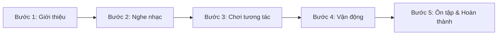

# PRODUCT REQUIREMENTS DOCUMENT (PRD)
# DỰ ÁN: LITTLE MELODY – SING, PLAY & LEARN!

---

## THÔNG TIN TÀI LIỆU
- **Tên sản phẩm:** Little Melody – Sing, Play & Learn!
- **Loại sản phẩm:** Ứng dụng Web / Web Game giáo dục âm nhạc tương tác
- **Phiên bản:** 1.0 (MVP)
- **Đối tượng người dùng chính:** Trẻ mầm non 3–4 tuổi & Phụ huynh
- **Trạng thái:** Dự thảo phê duyệt (Draft)
- **Ngày lập:** 15/10/2026

---

## 1. TỔNG QUAN & MỤC TIÊU SẢN PHẨM (EXECUTIVE SUMMARY)

### 1.1. Mô tả sản phẩm
**Little Melody** là trò chơi giáo dục tiếng Anh tương tác dành cho trẻ mầm non từ 3–4 tuổi. Ứng dụng kết hợp hài hòa giữa **Âm nhạc**, **Hoạt hình 2D**, **Hình ảnh trực quan sinh động** và **Vận động thể chất (Kinesthetic learning)** để giúp trẻ làm quen với từ vựng tiếng Anh đầu đời một cách tự nhiên, vui vẻ và không áp lực.

Trẻ ở độ tuổi này **không cần biết đọc hoặc viết**. Mỗi bài học được thiết kế như một trò chơi âm nhạc ngắn (3–5 phút), có nhân vật đại diện đồng hành là **Rồng Con (Little Dragon mascot)** dẫn dắt bằng tiếng Việt và phát âm chuẩn từ vựng bằng tiếng Anh.

### 1.2. Mục tiêu sản phẩm (Product Goals)
- **Khơi gợi hứng thú:** Tạo phản xạ tích cực và niềm yêu thích tự nhiên với âm thanh tiếng Anh.
- **Nhận diện từ vựng:** Bước đầu nhận biết và phát âm theo các từ vựng thân thuộc quanh bé.
- **Nghe hiểu & Phản xạ:** Lắng nghe chỉ dẫn đơn giản và phản ứng thông qua thao tác chạm/kéo thả hoặc động tác cơ thể.
- **Trải nghiệm an toàn:** Tuân thủ tiêu chuẩn giáo dục mầm non và khuyến nghị từ UNICEF về thời lượng tương tác màn hình an toàn và có sự đồng hành của phụ huynh.

---

## 2. NGƯỜI DÙNG MỤC TIÊU (TARGET AUDIENCE & PERSONAS)

| Nhóm người dùng | Đặc điểm & Nhu cầu | Kỳ vọng trải nghiệm |
| :--- | :--- | :--- |
| **Bé mầm non (3–4 tuổi)** | - Chưa biết chữ, khả năng tập trung ngắn (3–5 phút).<br>- Tiếp thu tốt qua âm thanh, giai điệu, màu sắc và bắt chước động tác.<br>- Thao tác tay (fine motor skills) đang phát triển. | - Nút bấm to, dễ chạm, không phạt khi bấm sai.<br>- Giai điệu bắt tai, nhân vật dễ thương, cổ vũ nồng nhiệt.<br>- Không cần đọc hướng dẫn bằng chữ. |
| **Phụ huynh (Parents)** | - Quan tâm đến phương pháp giáo dục sớm lành mạnh.<br>- Lo ngại trẻ "nghiện" màn hình hoặc tiếp xúc nội dung độc hại.<br>- Muốn biết bé đã tiếp thu được gì mà không gây áp lực thi cử. | - Có công cụ giới hạn thời gian chơi (nhắc nghỉ).<br>- Nắm được danh mục từ vựng bé đã làm quen.<br>- Hướng dẫn phụ huynh cách tương tác, chơi cùng con ngoài đời thực. |

---

## 3. PHẠM VI SẢN PHẨM (PRODUCT SCOPE)

### 3.1. Trong phạm vi phiên bản MVP (In-Scope)
- **Màn hình Trang chủ (Home Screen):** Giao diện sinh động với nhân vật Rồng Con chào đón bé.
- **6 Chủ đề bài học cơ bản:** Đầy đủ nội dung theo danh mục thiết kế.
- **6 Bài học tương tác âm nhạc:** Độ dài 3–5 phút/bài theo quy trình chuẩn 5 bước.
- **Hệ thống Audio song ngữ:** Giọng lồng tiếng Việt dẫn dắt + Phát âm bản ngữ tiếng Anh + Nhạc nền vui nhộn.
- **Cơ chế tương tác cảm ứng:** Chạm chọn (Tap), Kéo thả (Drag & Drop), Lắng nghe và Bắt chước vận động (Action imitation).
- **Lưu trữ dữ liệu cục bộ (LocalStorage):** Lưu tiến trình bài học, từ vựng đã học ngay trên thiết bị.
- **Góc phụ huynh (Parent Zone):** Dashboard thống kê thời gian, từ vựng, cài đặt âm lượng, hẹn giờ nghỉ và cẩm nang chơi cùng bé.
- **Giao diện đa nền tảng (Responsive):** Tối ưu hóa cho màn hình dọc (Mobile portrait), tự co giãn thích ứng với Máy tính bảng (Tablet) và Máy tính bàn (Desktop).

### 3.2. Ngoài phạm vi MVP / Kế hoạch tương lai (Out-of-Scope)
- Đăng ký tài khoản, đăng nhập qua Email / Mạng xã hội / SSO.
- Cổng thanh toán, gói thuê bao (Subscription / In-app purchases).
- Bảng xếp hạng cạnh tranh (Leaderboards) hoặc cơ chế trừ điểm.
- AI hội thoại, chatbot thông minh.
- Nhận diện giọng nói (Speech-to-Text) hoặc camera theo dõi chuyển động.
- Hệ thống backend đám mây (Cloud synchronization).

---

## 4. CẤU TRÚC CHƯƠNG TRÌNH & 6 CHỦ ĐỀ HỌC TẬP

### 4.1. Danh mục 6 chủ đề chính

| STT | Tên chủ đề | Từ vựng trọng tâm | Gameplay / Hình thức tương tác chính |
| :---: | :--- | :--- | :--- |
| **1** | **Hello World** | *Hello, Bye-bye, Thank you* | Bé cùng Rồng Con hát bài hát chào hỏi, vẫy tay chạm vào các bạn động vật để chào và tạm biệt. |
| **2** | **Color Party** | *Red, Blue, Yellow, Green* | Rồng Con yêu cầu màu sắc, bé chạm chọn đúng chùm bóng bay sắc màu để bóng bay lên trời. |
| **3** | **Animal Dance** | *Cat, Dog, Duck, Cow* | Nghe tiếng kêu và giai điệu, đoán con vật sau bụi cây; bắt chước vũ điệu của các con vật. |
| **4** | **Yummy Fruits** | *Apple, Banana, Orange* | Trò chơi kéo thả: Thu hoạch trái cây rơi từ trên cây bỏ vào giỏ theo yêu cầu của Rồng Con. |
| **5** | **Count & Jump** | *One, Two, Three, Four, Five* | Đếm số lượng ngôi sao/bước chân cùng Rồng Con, bé nhún nhảy theo nhịp đếm từ 1 đến 5. |
| **6** | **Move Your Body** | *Clap, Jump, Dance, Stop* | Rồng Con làm mẫu động tác; bé làm theo chỉ dẫn âm nhạc (vỗ tay, nhảy, nhảy múa và đứng im khi có hiệu lệnh "Stop"). |

### 4.2. Cấu trúc chuẩn 5 bước của mỗi bài học (5-Step Lesson Flow)
Mỗi bài học kéo dài từ **3–5 phút**, đảm bảo không làm trẻ quá tải và duy trì sự chú ý tối đa:



1. **Bước 1 - Giới thiệu (Intro - ~30s):**
   - Rồng Con xuất hiện vẫy tay, chào bé bằng tiếng Việt thân mật và giới thiệu chủ đề hôm nay (ví dụ: *"Hôm nay chúng mình cùng đi dự tiệc màu sắc với tớ nhé!"*).
2. **Bước 2 - Nghe nhạc & Làm quen (Listen & Sing - ~60s):**
   - Bài hát ngắn vui nhộn vang lên, từ vựng khóa được lặp lại nhịp nhàng kèm hình ảnh minh họa chuyển động bắt mắt.
3. **Bước 3 - Chơi tương tác (Interactive Play - ~90s):**
   - Mini-game chạm/kéo thả củng cố từ vựng (chọn bóng bay, xếp quả vào giỏ, tìm bạn động vật).
4. **Bước 4 - Vận động cùng Rồng Con (Kinesthetic Action - ~45s):**
   - Rồng Con hướng dẫn bé đứng lên hoặc làm động tác tại chỗ (vỗ tay, nhún nhảy, làm tai mèo,...).
5. **Bước 5 - Ôn tập & Khen thưởng (Review & Celebration - ~30s):**
   - Rồng Con nhắc lại các từ đã gặp, pháo hoa giấy (confetti) bung nở rực rỡ, trao huy hiệu sao vui vẻ và kết thúc bài học.

---

## 5. QUY TẮC VẬN HÀNH & TƯƠNG TÁC (GAMEPLAY RULES & MECHANICS)

### 5.1. Phản hồi tích cực & Không phạt (Positive Reinforcement)
- **Khi bé chọn đúng:**
  - Phát lại âm thanh phát âm chuẩn bản ngữ của từ vựng tiếng Anh đó (kèm chữ phụ đề mờ cho phụ huynh xem nếu cần).
  - Nhân vật Rồng Con nhảy múa, vỗ tay, mỉm cười và nói lời khen ngợi bằng giọng Việt lảnh lót (*"Hoan hô bé!", "Tuyệt vời quá!", "Good job!"*).
  - Hiệu ứng ngôi sao lấp lánh / âm thanh chuông ngân vui tai.
- **Khi bé chọn sai:**
  - **Tuyệt đối không có âm thanh chói tai (buzz/x-mark)**, không trừ điểm, không hiện biểu tượng dấu X đỏ gây thất vọng.
  - Rồng Con nghiêng đầu dịu dàng, khích lệ bé thử lại (*"Ồ, quả này màu xanh mà, bé thử tìm quả màu đỏ cạnh bên xem sao nhé!"*).
  - Đối tượng chọn sai rung nhẹ (gentle wobble) rồi trở về vị trí cũ để bé tự do chọn lại.
- **Khi bé không thao tác (Idle state - quá 10–15 giây):**
  - Hệ thống không hối thúc dồn dập.
  - Sau 12 giây không chạm, Rồng Con có cử động vẫy tay hoặc đối tượng gợi ý nhấp nháy hào quang nhẹ (gentle glow) để thu hút sự chú ý trở lại của bé.

### 5.2. Luồng hoàn thành bài học (Lesson Completion)
- Kết thúc 5 bước, màn hình chúc mừng hiện ra với biểu tượng cúp/ngôi sao vàng.
- Tiến độ bài học và từ vựng mới được tự động lưu vào LocalStorage.
- Ba nút bấm to, rõ ràng:
  1. **Chơi lại (Replay):** Chơi lại bài học vừa xong.
  2. **Bài tiếp theo / Về trang chủ (Home / Next):** Chọn chủ đề khác.
  3. **Nghỉ ngơi (Rest):** Màn hình Rồng Con ngủ khò đáng yêu, báo hiệu bé nên nghỉ ngơi cho mắt thư giãn.

### 5.3. Xử lý sự cố âm thanh (Audio Error Fallback)
- Nếu trình duyệt chặn Autoplay hoặc không tải được file audio:
  - Game tuyệt đối không bị treo hoặc đơ giao diện.
  - Hiển thị nút biểu tượng **"Loa / Nghe lại"** to nhấp nháy để phụ huynh/bé chạm kích hoạt lại AudioContext.
  - Thông báo nhẹ nhàng hiển thị để phụ huynh hỗ trợ bật tiếng.

---

## 6. YÊU CẦU GIAO DIỆN & TRẢI NGHIỆM (UI/UX SPECIFICATIONS)

### 6.1. Phong cách mỹ thuật (Visual Aesthetics)
- **Đồ họa:** 2D Cartoon hoạt hình cao cấp, nét vẽ tròn trịa, thân thiện, ấm áp.
- **Màu sắc:** Tươi sáng, rực rỡ (Pastel & Bright tones: Vàng nắng, Xanh da trời, Xanh lá cây tươi, Cam ấm), độ tương phản vừa phải, không gây chói mắt.
- **Nhân vật Rồng Con:**
  - Là người bạn đồng hành xuyên suốt các màn hình.
  - Có các bộ biểu cảm phong phú (vui vẻ, ngạc nhiên, nhảy múa, vẫy tay, hướng dẫn chỉ tay, ngủ khò).
- **Nguyên tắc an toàn thị giác cho trẻ mầm non:**
  - Không sử dụng hiệu ứng đèn nhấp nháy tần số cao (chống kích ứng thần kinh/động kinh quang học - Photosensitive seizure safety).
  - Chuyển cảnh mềm mại (fade/slide nhẹ nhàng).

### 6.2. Thiết kế giao diện & Công thái học cho bé (Child-Friendly Ergonomics)
- **Tối giản chữ viết:** Trẻ 3–4 tuổi chưa biết đọc, do đó 95% chỉ dẫn phải truyền tải bằng **Hình ảnh trực quan** và **Giọng nói**.
- **Kích thước nút bấm (Hit targets):** Tối thiểu 64x64px (tối ưu 80x80px trên thiết bị cảm ứng), khoảng cách giữa các nút đủ lớn để tránh chạm nhầm.
- **Điều hướng thường trực (Universal Controls):**
  - Nút **Quay lại (Back / Home)** luôn ở góc trên bên trái.
  - Nút **Tạm dừng / Bật tắt âm lượng (Pause / Mute)** ở góc trên bên phải.
  - Nút **Nghe lại (Replay Sound)** dễ dàng chạm tới.
- **Đáp ứng đa thiết bị (Responsive Layout):**
  - **Điện thoại di động (Mobile Portrait):** Ưu tiên hàng đầu (tỉ lệ 9:16 hoặc 9:19.5), thiết kế vừa vặn tầm với ngón tay của trẻ.
  - **Máy tính bảng (Tablet) & Máy tính bàn (Desktop):** Giao diện tự động co giãn theo khung tỉ lệ an toàn (Canvas fixed aspect-ratio with decorative borders), không bị biến dạng hình ảnh.

---

## 7. GÓC PHỤ HUYNH & TIÊU CHUẨN AN TOÀN TRẺ EM (PARENT ZONE)

### 7.1. Cổng vào an toàn cho người lớn (Parental Gate)
- Để vào "Góc phụ huynh", cần vượt qua thử thách phép tính số học đơn giản bằng chữ (Ví dụ: *"Ba cộng hai bằng mấy?"* hoặc chạm giữ 3 giây) nhằm ngăn trẻ vô tình bấm vào can thiệp cài đặt.

### 7.2. Các tính năng chính trong Góc Phụ Huynh

| Tính năng | Chi tiết chức năng |
| :--- | :--- |
| **Nhật ký bài học** | Xem các bài bé đã hoàn thành, tổng số lần tương tác đúng. |
| **Bảng từ vựng bé đã gặp** | Danh sách các từ tiếng Anh bé đã được nghe và làm quen (kèm nghĩa tiếng Việt và nút bấm nghe phát âm thử). |
| **Thời lượng sử dụng (Screen Time)** | Đo lường số phút bé đã tương tác trong ngày/tuần. |
| **Nhắc nhở nghỉ ngơi (Timer)** | Cho phép phụ huynh đặt giới hạn thời gian (ví dụ: sau 15 hoặc 20 phút), Rồng Con sẽ rủ bé đi uống nước và vận động ngoài trời. |
| **Cài đặt hệ thống** | Tinh chỉnh âm lượng nhạc nền riêng, âm lượng giọng đọc riêng; Xóa sạch tiến trình để chơi lại từ đầu. |
| **Cẩm nang chơi cùng con** | Hướng dẫn phụ huynh cách sử dụng các từ vựng này trong sinh hoạt hàng ngày theo khuyến nghị của **UNICEF Parenting**. |

> **Lưu ý triết lý giáo dục quan trọng:**
> Ứng dụng **không dùng** các chỉ số đo lường để xếp hạng hoặc khẳng định mức độ "thành thạo/giỏi tiếng Anh" của trẻ. Mục tiêu duy nhất là ghi nhận sự tiếp xúc tích cực và khuyến khích niềm vui khám phá ngôn ngữ.

---

## 8. KIẾN TRÚC KỸ THUẬT & YÊU CẦU PHI CHỨC NĂNG (TECHNICAL SPECIFICATIONS)

### 8.1. Tech Stack đề xuất
- **Frontend Core:** React 18+ (Functional Components & Hooks), TypeScript (đảm bảo type-safety tuyệt đối cho dữ liệu bài học).
- **Build Tool:** Vite (khởi động nhanh, bundle siêu nhẹ, hot reload tức thì).
- **Styling:** CSS3 thuần / CSS Modules (Animations, Flexbox, CSS Grid, Responsive Media Queries linh hoạt, không phụ thuộc thư viện nặng).
- **Animation:** CSS Keyframes / SVG SMIL / SVG Morphing & Canvas nhẹ.
- **Audio Engine:** HTML5 Audio API kết hợp Web Audio API (quản lý AudioContext, Sound FX, BGM loop và Speech playback trơn tru).
- **Lưu trữ dữ liệu:** `window.localStorage` (lưu trữ JSON nhẹ, không cần database server).
- **Quản lý mã nguồn & Triển khai:** Git, GitHub repository; Static Web Hosting (Vercel, Netlify, hoặc GitHub Pages).

### 8.2. Cấu trúc tách biệt dữ liệu & Logic (Decoupled Content Architecture)
Mỗi bài học được định nghĩa bằng một cấu trúc dữ liệu JSON/TypeScript độc lập, giúp việc mở rộng thêm bài học số 7, 8... trong tương lai không làm thay đổi core engine:

```typescript
// Cấu trúc mẫu cho một bài học (Lesson Schema)
interface LessonData {
  id: string; // 'color-party'
  title: string; // 'Color Party'
  topic: string; // 'Colors'
  mascotGreetingVi: string; // Voice intro tiếng Việt
  vocabulary: Array<{
    word: string; // 'Red'
    meaningVi: string; // 'Màu đỏ'
    audioEnUrl: string; // File âm thanh tiếng Anh chuẩn
    imageUrl: string; // Hình ảnh minh họa SVG/PNG
  }>;
  steps: {
    intro: IntroStepConfig;
    song: SongStepConfig;
    game: GameStepConfig;
    movement: MovementStepConfig;
    review: ReviewStepConfig;
  };
}
```

### 8.3. Yêu cầu phi chức năng (Non-Functional Requirements)
- **Hiệu năng & Tốc độ tải (Performance):** Dung lượng tải ban đầu (Initial Bundle) < 2MB; Asset âm thanh nén định dạng MP3/AAC chất lượng tốt nhưng dung lượng tối ưu.
- **Khả năng chạy Offline (Offline Capability):** Ứng dụng có thể lưu trữ asset tĩnh qua Cache/Service Worker để chơi mượt mà ngay cả khi mất mạng.
- **Tính ổn định (Reliability):** Không có lỗi JavaScript unhandled gây văng trắng trang; khi audio không phát được phải có cơ chế bỏ qua an toàn.

---

## 9. KẾ HOẠCH TRIỂN KHAI & TIÊU CHÍ NGHIỆM THU (ROADMAP & ACCEPTANCE CRITERIA)

### 9.1. Lộ trình phát triển 5 giai đoạn

| Giai đoạn | Nội dung công việc | Kết quả bàn giao (Deliverables) |
| :---: | :--- | :--- |
| **Giai đoạn 1** | Khởi tạo dự án Vite + React + TS; Dựng khung Shell ứng dụng, hệ thống Design Tokens (Màu sắc, Typography, Nút bấm), Component nhân vật Rồng Con với các biểu cảm cơ bản. | Màn hình Trang chủ hoạt động, điều hướng mượt mà, Rồng Con chuyển động. |
| **Giai đoạn 2** | Triển khai bài học mẫu hoàn chỉnh đầu tiên (**Color Party** hoặc **Animal Dance**) tích hợp đầy đủ 5 bước bài học, Audio Engine và mini-game tương tác. | Một bài học chơi hoàn chỉnh từ đầu đến cuối không lỗi. |
| **Giai đoạn 3** | Xây dựng 5 bài học còn lại (*Hello World, Animal Dance, Yummy Fruits, Count & Jump, Move Your Body*). | Toàn bộ 6 bài học hoạt động trơn tru với đầy đủ âm thanh và tương tác. |
| **Giai đoạn 4** | Xây dựng phân hệ Góc Phụ Huynh, Parental Gate, cơ chế lưu tiến trình LocalStorage, tinh chỉnh âm lượng và hẹn giờ nghỉ. Kiểm thử toàn diện trên Mobile, Tablet, PC. | Bản Beta hoàn chỉnh sẵn sàng cho chạy thử nghiệm người dùng. |
| **Giai đoạn 5** | Thử nghiệm với nhóm trẻ mầm non và phụ huynh; Thu thập ý kiến phản hồi, tinh chỉnh tốc độ giọng nói, kích thước nút và độ nhạy tương tác. | Phiên bản v1.0 Release sẵn sàng phát hành chính thức. |

### 9.2. Điều kiện nghiệm thu kỹ thuật (Technical Acceptance Criteria)
1. Mọi trò chơi mini-game đều có tương tác thực (chạm, kéo thả, âm thanh phản hồi); **tuyệt đối không có nút giả hoặc tính năng hình thức**.
2. Toàn bộ các nút điều hướng (Về trang chủ, Quay lại, Nghe lại, Tắt mở tiếng) phản hồi tức thì, không bao giờ kẹt màn hình.
3. Trẻ không cần biết đọc bất kỳ chữ cái nào vẫn có thể trải nghiệm trọn vẹn thông qua giọng nói hướng dẫn của Rồng Con và hình ảnh trực quan.
4. Kiểm thử thành công trên cả thiết bị màn hình cảm ứng (Smartphone iOS/Android, iPad/Tablet) và máy tính bàn dùng chuột.

---

## 10. TIÊU CHÍ ĐÁNH GIÁ SẢN PHẨM & THỬ NGHIỆM (SUCCESS METRICS)

Các chỉ số mục tiêu đề xuất cho đợt thử nghiệm Pilot (nhóm 15–20 trẻ độ tuổi 3–4 cùng phụ huynh):

- **Độ trực quan & Dễ tiếp cận (Accessibility):** $\ge 80\%$ trẻ trong nhóm thử nghiệm có thể tự bắt đầu và hoàn thành bài chơi với tối đa 01 lần hỗ trợ ban đầu từ người lớn.
- **Mức độ hài lòng của phụ huynh (Parent Satisfaction):** $\ge 80\%$ phụ huynh đánh giá hướng dẫn rõ ràng, an tâm khi con trải nghiệm và yêu thích tính năng hẹn giờ nghỉ ngơi.
- **Tính ổn định của phần mềm (Zero Critical Bugs):** $0\%$ lỗi nghiêm trọng khiến trẻ bị kẹt hoặc buộc phải tắt trình duyệt giữa chừng.
- **Độ phù hợp nội dung:** $100\%$ phụ huynh xác nhận hình ảnh thân thiện, âm lượng vừa phải, không có yếu tố gây giật mình hay sợ hãi cho trẻ nhỏ.
- **Tương tác thể chất & Ngôn ngữ:** Quan sát thấy ít nhất $75\%$ trẻ có phản ứng tích cực: cười vui, nhún nhảy, vỗ tay hoặc lặp lại từ vựng theo Rồng Con trong các bước vận động và nghe nhạc.

---
*Tài liệu được biên soạn dựa trên định hướng phương pháp tiếp cận giáo dục mầm non tiên tiến và tiêu chuẩn an toàn cho trẻ em của UNICEF Parenting.*
